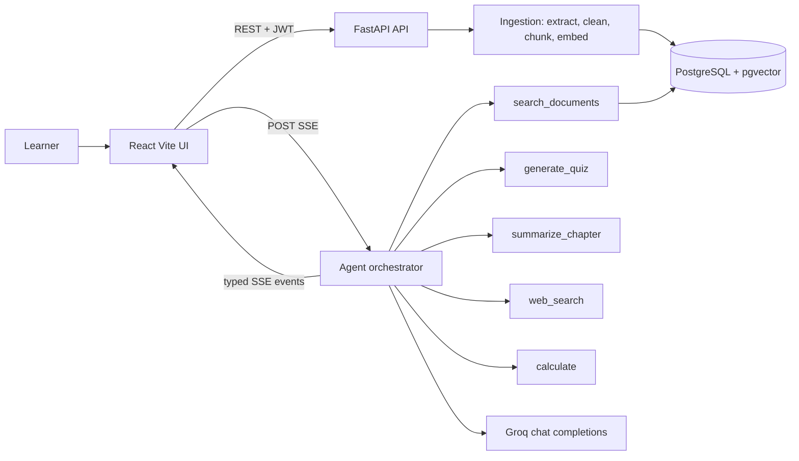

# StudyMate AI

An AI study assistant that turns uploaded course material into a grounded, cited study
companion: ask questions, generate quizzes, summarise chapters, and let an agent choose
between document search, web search and a calculator.

**Primary workflow:** upload → extract → chunk → embed → retrieve → agent tool selection →
grounded answer with verified citations.

---

## 1. Problem and approach

A plain RAG chatbot always retrieves passages and answers. StudyMate AI is **agentic**: it decides
what evidence a request needs, calls only the tools that fit, checks whether the evidence is
strong enough, and refuses to assert document claims the material does not support.

| Learner request | What the agent does |
| --- | --- |
| "Explain normalization from my notes." | `search_documents` → cited explanation |
| "Create five questions on SQL joins." | `generate_quiz` → schema-validated 5-question quiz |
| "Summarize Chapter 3." | `summarize_chapter` → summary of that section only |
| "What is the current stable Python version?" | `web_search`, labelled as external |
| "Calculate the accuracy if 85 of 100 predictions are correct." | `calculate` → validated arithmetic |
| "What is the capital of France?" | Answers directly, without pretending it came from the file |
| "Explain a topic not in my PDF." | States the material lacks evidence; offers external research |
| Prompt-injection text inside a PDF | Treated as untrusted data, never as instructions |

## 2. Features

- **Document library** — PDF/TXT upload, processing status (Processing → Ready / Failed), delete.
- **Grounded chat** — streamed answers, markdown rendering, clickable `[n]` citations that open
  the exact filename, page, section and passage.
- **Five agent tools** — document search, quiz generation, chapter summary, web search, calculator.
- **Visible agent activity** — "Searching your documents", "Generating a quiz", "Searching the web",
  plus the tools used on each answer.
- **Study panel** — interactive multiple-choice quiz with per-question explanations and score, and
  section summaries with sources.
- **History** — conversations and messages persist, with citations restored on reload.
- **Guardrails** — insufficient-evidence handling, off-topic redirection, prompt-injection
  resistance, ownership checks, upload validation, safe calculator, per-user rate limits.
- **Accounts** — email/password with bcrypt hashes and short-lived JWT access tokens.

## 3. Stack

| Layer | Choice |
| --- | --- |
| Frontend | React 18 + Vite, Bootstrap 5, Axios, React Markdown, native `fetch` for SSE |
| Backend | Python 3.12 + FastAPI, Pydantic v2, SQLAlchemy 2, SQLite fallback |
| Database | PostgreSQL without pgvector or SQLite for local runs (JSON vectors scored in Python) |
| LLM | **Groq** (`openai/gpt-oss-120b` by default) — native tool calling + streaming |
| Embeddings | `fastembed` running `sentence-transformers/all-MiniLM-L6-v2` locally (384 dims) |
| PDF parsing | PyMuPDF |
| Web search | DuckDuckGo HTML (keyless) or Tavily when a key is configured |
| Tests | Pytest + FastAPI TestClient |

## 4. Architecture



```
frontend/src/
├── components/{layout,documents,chat,study,common}
├── pages/{LoginPage,DashboardPage}.jsx
├── hooks/useChatStream.js
├── services/{api,chatService,documentService}.js
└── App.jsx

backend/app/
├── main.py
├── api/{auth,documents,chat,study,deps}.py
├── core/{config,security,logging,ratelimit}.py
├── db/{models,session,types}.py
├── services/{document_processor,chunker,embeddings,retriever,citation_service,llm_service}.py
├── agent/{orchestrator,prompts,evidence}.py
├── agent/tools/{document_search,quiz_generator,summarizer,web_search,calculator}.py
└── schemas/{auth,documents,chat,study}.py
```

## 5. RAG pipeline

1. **Ingestion** — extension, size (15 MB), MIME and magic-byte checks; PDFs are parsed page by
   page with PyMuPDF, TXT files decoded with encoding fallbacks. Image-only/encrypted PDFs fail
   with a clear message instead of an empty index.
2. **Cleaning** — whitespace normalisation, de-hyphenation across line breaks, control-character
   removal; headings, lists and code structure preserved.
3. **Chunking** — heading-aware blocks, ~700 tokens per chunk with ~100 tokens overlap, paragraph
   boundaries preferred, character-level overlap when a single block exceeds the overlap budget.
   Every chunk keeps `page_number`, `section_title`, `chunk_index`.
4. **Embeddings** — the same local MiniLM model embeds chunks and queries. The model name is stored
   on each document so an index can be rebuilt after a model change.
5. **Vector storage** — pgvector `vector(384)` column with an HNSW cosine index when the extension
   is installed. PostgreSQL without pgvector, and SQLite, store vectors as JSON and score with
   NumPy; the startup log reports `vectors=pgvector` or `vectors=python`.
6. **Retrieval** — filtered by the authenticated user's documents and selected document IDs, top-k
   (default 5), returning similarity and full source metadata.
7. **Answering** — evidence is rendered into a delimited `<document_evidence>` block in the system
   prompt; citation numbers are assigned by the backend.

### Citations

- Evidence is numbered `[1] … [n]` in retrieval order by `citation_service.build_citations`.
- The model may only cite those numbers; after streaming, any invented marker (`[7]` with no
  source) is stripped and the final text is sent in the `done` event.
- `messages.citations_json` stores only the sources the answer actually referenced, and the UI
  expands each one to the filename, page, section heading and quoted passage.

## 6. Agent tools and routing

The orchestrator runs in two phases so evidence is validated before any token is streamed:

1. **Planning** (Groq native tool calling, `max_tool_calls = 4`): the model calls only the tools it
   needs, then stops. Arguments are parsed and validated; unknown tool names, bad JSON and tool
   exceptions are returned to the model as errors rather than crashing the turn. Once a tool
   succeeds, planning stops instead of spending another LLM round; a failed tool keeps the loop
   open so the model can try a fallback (for example web search after an empty document search).
2. **Answering** (streaming, no tools): the model receives the gathered evidence and writes the
   cited answer.

An explicit, unambiguous request ("create five questions on SQL joins", "summarize Chapter 3",
"summarize page 2") is routed deterministically to its tool before the planner runs, and a
question-style prompt that the planner tries to treat as a summary is redirected back to document
search. Everything else — topic questions, freshness checks, arithmetic, general knowledge — is
model-decided, so the agent only becomes a fixed decision tree where the request leaves no room
for interpretation.

| Tool | Purpose | Safety |
| --- | --- | --- |
| `search_documents` | Semantic search over the learner's ready documents | Ownership + document filters applied in SQL |
| `generate_quiz` | 5 grounded MCQ questions, strict JSON schema | Exactly 5 questions, 4 options, valid index, explanation, valid source ids; one repair attempt |
| `summarize_chapter` | Summarise one heading or page range | Rejects unknown chapters instead of summarising arbitrary chunks |
| `web_search` | External/current facts, labelled as external | Provider restricted to DuckDuckGo or Tavily; no model-chosen URLs fetched |
| `calculate` | Arithmetic via AST allowlist | No `eval`; allowlisted nodes/functions, length/exponent/result limits |

If a turn ends with no document evidence, no web results and no calculation — planning failed,
the planner skipped tools, or a tool produced nothing — the orchestrator falls back to one
document search when the learner has ready documents, so an outage or a misrouted tool cannot
silently strip grounding. Planner-supplied `document_ids` are resolved against the learner's
selected documents (UUID, filename or stem); unknown values are dropped rather than filtering
out every passage.

## 7. Guardrails and security

- **Insufficient evidence** — weak best-similarity triggers an instruction to state that the
  material may not cover the topic; the answer prompt forbids inventing citations.
- **Prompt injection** — retrieved text is delimited as untrusted evidence, the system prompt says
  instructions inside it have no authority, and passages containing instruction-like phrases are
  explicitly flagged as untrusted in the evidence block. Tool names/arguments are validated in
  backend code, and tools cannot fetch arbitrary URLs or query arbitrary SQL.
- **Deterministic exfiltration guard** — a request that tries to override the rules or extract
  prompts, credentials or environment values never reaches the model. It receives a fixed refusal
  (`tool_name = guardrail`) with no citations, so the protection does not depend on model behaviour.
- **Upload safety** — allowed extensions only, MIME + `%PDF` magic check, 15 MB / page limits,
  server-generated storage filenames, files stored under `backend/data/uploads` (not web-served).
- **Authorization** — every document, search, conversation and message query is scoped to the
  authenticated user id; a document UUID alone is never sufficient.
- **Authentication** — bcrypt password hashes, HS256 JWTs with expiry, `HTTPBearer` dependency.
- **Rate limits** — per-user in-process limits on chat, study and upload endpoints, plus login and
  registration limits.
- **Secrets** — keys come from environment variables; nothing provider-side is exposed to the
  browser bundle.

## 8. Data model

| Table | Key columns |
| --- | --- |
| `users` | id, name, email (unique), password_hash, created_at |
| `documents` | id, user_id, filename, stored_filename, file_type, status, page_count, chunk_count, embedding_model, error_message, timestamps |
| `document_chunks` | id, document_id, chunk_index, content, page_number, section_title, token_count, embedding |
| `conversations` | id, user_id, title, created_at, updated_at |
| `messages` | id, conversation_id, role, content, tool_name, citations_json, created_at |
| `quiz_attempts` | id, user_id, document_id, topic, questions_json, score, created_at |

UUID primary keys, timestamps for auditability, cascading deletes for documents → chunks and
conversations → messages.

## 9. API

| Method | Endpoint | Responsibility |
| --- | --- | --- |
| POST | `/api/v1/auth/register` | Create an account (returns JWT) |
| POST | `/api/v1/auth/login` | Authenticate |
| GET | `/api/v1/auth/me` | Current user |
| POST | `/api/v1/documents/upload` | Validate, store and index a PDF/TXT |
| GET | `/api/v1/documents` | List the user's documents |
| GET | `/api/v1/documents/{id}` | Status and metadata |
| DELETE | `/api/v1/documents/{id}` | Delete document + chunks + stored file |
| POST | `/api/v1/documents/{id}/search` | Passage search inside one document |
| POST | `/api/v1/chat/stream` | SSE agent response |
| GET | `/api/v1/conversations` | List conversations |
| GET | `/api/v1/conversations/{id}/messages` | History with citations |
| POST | `/api/v1/study/quiz` | Generate a grounded quiz |
| POST | `/api/v1/study/summary` | Summarise a section |
| GET | `/health` | Status, DB backend, model and embedding info |

### SSE events from `/chat/stream`

`meta` (conversation id) → `activity` (tool running/done with a human label) → `sources` (numbered
citations) → optional `quiz` → many `token` deltas → `done` (validated text, references, tools,
external sources, calculations) or `error`.

## 10. Local setup

**Prerequisites:** Python 3.12+, Node 20+. Docker is optional but needed for PostgreSQL/pgvector.

```bash
# 1. Python environment
python -m venv .venv
# Windows:
.venv/Scripts/python -m pip install -r backend/requirements.txt
# macOS/Linux:
# source .venv/bin/activate && pip install -r backend/requirements.txt

# 2. Configuration
cp .env.example .env
# set GROQ_API_KEY (required) and SECRET_KEY (use a long random value)
```

**Run the backend** (SQLite local database by default):

```bash
cd backend
# Windows
../.venv/Scripts/python -m uvicorn app.main:app --reload --port 8000
# macOS/Linux
# ../.venv/bin/python -m uvicorn app.main:app --reload --port 8000
```

**Run the frontend:**

```bash
cd frontend
npm install
npm run dev        # http://localhost:5173 (proxies /api to :8000)
```

On first use the embedding model (~90 MB) is downloaded by `fastembed`. For offline or CI runs set
`EMBEDDING_PROVIDER=hash` — retrieval then matches on token overlap rather than meaning, and the
provider is reported in `/health` and document metadata.

## 11. Docker Compose

```bash
cp .env.example .env   # set GROQ_API_KEY
docker compose up --build
```

- Frontend: <http://localhost:8080> (nginx proxies `/api` to the backend with buffering off so SSE streams)
- Backend: <http://localhost:8000> · API docs: <http://localhost:8000/docs>
- Database: PostgreSQL 16 + pgvector on `localhost:5432`; tables are created on startup, and the
  extension plus HNSW index when the server ships pgvector. See `docs/postgres-migration.md` for
  moving an existing SQLite database across.

## 12. Environment variables

| Variable | Default | Notes |
| --- | --- | --- |
| `APP_ENV` | `development` | Runtime environment label |
| `SECRET_KEY` | dev placeholder | JWT signing key — set a long random value |
| `ACCESS_TOKEN_EXPIRE_MINUTES` | `720` | Access-token lifetime |
| `CORS_ORIGINS` | `http://localhost:5173` | Comma-separated allowed origins |
| `DATABASE_URL` | SQLite `backend/data/studymate.db` | `postgresql+psycopg://…` for PostgreSQL (pgvector used automatically when installed) |
| `LLM_PROVIDER` | `groq` | Provider label |
| `GROQ_API_KEY` | — | Required for chat, quiz and summary |
| `LLM_MODEL` | `openai/gpt-oss-120b` | Any Groq model with tool-calling support (check `GET /openai/v1/models` for your key) |
| `LLM_TEMPERATURE` | `0.2` | Generation temperature |
| `EMBEDDING_PROVIDER` | `auto` | `auto`, `fastembed` or `hash` |
| `EMBEDDING_MODEL` | `sentence-transformers/all-MiniLM-L6-v2` | 384 dimensions |
| `WEB_SEARCH_PROVIDER` | `duckduckgo` | `duckduckgo` (no key) or `tavily` |
| `WEB_SEARCH_API_KEY` | — | Required only for Tavily |
| `MAX_UPLOAD_SIZE_MB` | `15` | Upload limit |
| `RETRIEVAL_TOP_K` | `5` | Passages retrieved per search |
| `RETRIEVAL_MIN_SIMILARITY` | `0.25` | Weak-evidence threshold for the prompt |
| `CHUNK_SIZE_TOKENS` / `CHUNK_OVERLAP_TOKENS` | `700` / `100` | Chunking configuration |
| `MAX_TOOL_CALLS` | `4` | Per-request tool budget |

## 13. Tests

```bash
cd backend
../.venv/Scripts/python -m pytest -q     # Windows
# python -m pytest -q                    # macOS/Linux
```

Coverage: registration/login/expiry handling, cross-user access denial, upload validation
(extension, spoofed PDF, empty, oversized), failed-PDF status, chunking metadata and overlap,
retrieval relevance and scoping, agent tool selection and SSE streaming, citation numbering and
invented-marker stripping, quiz schema validation and repair, summary section matching, prompt
injection flagging, and calculator abuse attempts.

## 14. Evaluation

```bash
# backend must be running with a valid GROQ_API_KEY
backend/.venv/Scripts/python evaluation/run_evaluation.py --limit 10
# full set (21 cases)
backend/.venv/Scripts/python evaluation/run_evaluation.py
```

The harness registers a throwaway account, uploads `evaluation/sample_documents/database-notes.pdf`
(4 chapters) plus an adversarial document, streams every question through the real agent, and
reports numerator/denominator metrics for tool selection, keyword answers, citation pages,
abstention, refusals, quiz schema validity, plus time-to-first-token and total latency. Raw results
are written to `evaluation/results.json`.

Metrics are only meaningful when generated from a run against the live model — no benchmark numbers
are claimed in this repository without a corresponding `results.json` (generated output, not
committed).

**What was verified locally** (Groq `openai/gpt-oss-120b`, 4-page sample PDF, 2026-10-30):

- Automated suite: **72 tests passing** (auth, ownership, upload validation, chunking, retrieval,
  agent streaming, citations, quiz validation/repair, summaries, router, calculator abuse,
  guardrails).
- An 8-case live smoke run passed **8/8**, including tool selection, citation pages, quiz schema
  validity and the calculator.
- A separate live run verified both prompt-injection cases are blocked (`tool_name = guardrail`,
  no prompt or secret leakage) and the abstention case for uncovered material.
- Median time to first streamed token in a clean run: ~10.6 s with planning enabled. Repeated
  full runs on a free Groq key can hit the provider rate limit; the harness reports those cases as
  failures rather than hiding them, which is why no aggregate benchmark is quoted here.

## 15. Design decisions

- **Groq for generation, local embeddings.** Groq offers fast tool-calling chat completions but no
  embeddings endpoint, so embeddings run locally with MiniLM. This keeps indexing free and means
  the exact same model preprocesses documents and queries. `hash` exists only as a CI/offline
  fallback and is labelled in the UI/health output.
- **Two-phase agent instead of one streamed tool loop.** Planning produces evidence; answering
  streams once. It costs one extra completion, but tool arguments and citations are validated
  before the learner sees a token, and the final answer cannot silently drop evidence.
- **pgvector over a separate vector database.** One database holds users, documents, chunks,
  embeddings and conversations, so ownership filters and vector search happen in one query. SQLite
  reranks in NumPy so the project still runs without Docker.
- **Citation contract.** The backend assigns numbers and validates markers; the model can only
  reference evidence it was given. This is stricter than letting the model produce page numbers.
- **Chunk size 700 / overlap 100, heading-aware.** Large enough to hold an explanation, small enough
  for precise page citations; heading boundaries keep chapters from blending into one chunk.
- **SSE over POST with `fetch`.** Streaming needs a request body for the message and selected
  documents, so `EventSource` (GET-only) is not usable. The client buffers bytes and parses complete
  frames, so split frames and cancellation are handled.
- **Strict section summaries.** If a heading or page range cannot be identified, the tool refuses
  instead of summarising unrelated chunks.

## 16. Known limitations

- No OCR for scanned PDFs (rejected with a clear message).
- Rate limiting is per process; a multi-instance deployment needs Redis or a gateway limit.
- SQLite fallback scores all of a user's chunks in Python; pgvector is required for large corpora.
- Retrieval is vector similarity plus a section-heading match, not a full-text/BM25 index or a
  cross-encoder reranker; similarity thresholds need tuning per embedding model.
- Time to first token is around 10 s with `gpt-oss-120b` at low reasoning effort, because planning
  completes before streaming starts. `openai/gpt-oss-20b` is notably faster if latency matters more
  than answer depth.
- DuckDuckGo's HTML endpoint can rate-limit; Tavily is supported as a keyed alternative.
- Chat streams are not resumable after a dropped connection; the partial answer is saved.
- Quiz scoring happens in the browser; `quiz_attempts` stores questions but not the learner's score.

## 17. Docs and demo

- `docs/architecture.md` — request flow, module responsibilities and design trade-offs.
- `docs/demo-script.md` — five-minute demo walkthrough.
- `evaluation/README.md` — how the harness and sample documents fit together.
